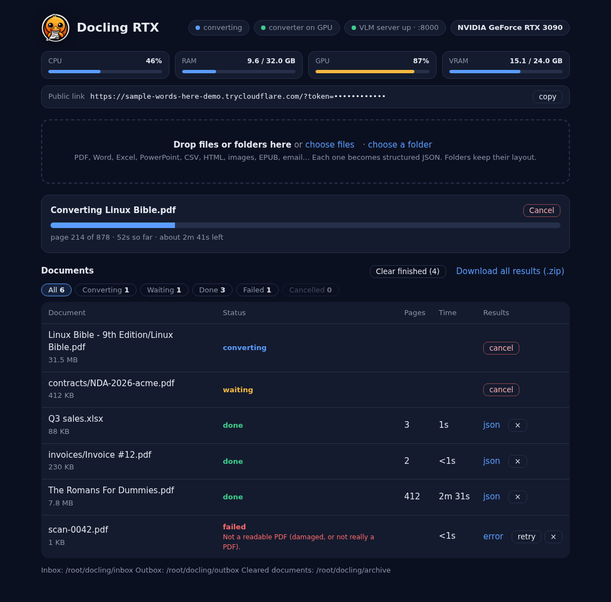

<p align="center"></p>

<h1 align="center">Docling RTX</h1>

<p align="center"><b>Turn any NVIDIA GPU box into a document → Markdown machine for AI agents, with one command.</b><br>
Drop PDFs, Office files, CSVs, HTML, images or whole folders on a web page. Get clean Markdown back for your agent, with structured JSON as an option.</p>

```bash
curl -fsSL https://raw.githubusercontent.com/codyvolckmar/docling-rtx/main/install.sh | bash
```

That's the whole setup. It takes **about 12 minutes on a fresh pod**, mostly downloading CUDA PyTorch and models, and ends by printing a **public HTTPS link** to your web page. Open it in any browser.

No `curl`? `wget -qO- https://raw.githubusercontent.com/codyvolckmar/docling-rtx/main/install.sh | bash`



## Features

- 🖱️ **Drag & drop web page:** files or whole folders (subfolders kept). Live page-by-page progress with time left, **cancel**, **retry**, a filter by status, and one-click JSON or a **zip of everything**.
- 🌍 **Public link out of the box:** a free Cloudflare tunnel gives the page an `https://….trycloudflare.com` address, protected by a key. No account and no open port, so it works on rented pods that expose nothing.
- 🤖 **Markdown for AI agents:** every document becomes compact Markdown, with headings, lists, tables and code in reading order, which is what LLMs read best. Optionally you also get **JSON** (a [DoclingDocument](https://docling-project.github.io/docling/concepts/docling_document/)) with page numbers, exact table cells and positions, for citations and programs. Files are written atomically, so an agent never reads half a file. Failures write `name.error.json` with the reason.
- 📂 **Drop folder too:** copy files into `~/docling/inbox`, and Markdown appears in `~/docling/outbox`. It's the same pipeline as the web page.
- ⚡ **GPU-accelerated:** [Docling](https://github.com/docling-project/docling)'s layout, table and OCR models on CUDA. Optionally, IBM's [granite-docling-258M](https://huggingface.co/ibm-granite/granite-docling-258M) vision model on vLLM for scans, formulas and code.
- 📊 **Live CPU / RAM / GPU / VRAM widget,** measured against your pod's real limits, plus a badge showing whether the converter runs on GPU or CPU.
- 🧰 **Made for rented GPU pods:** it picks the PyTorch build from your driver (525+), sizes everything to your VRAM, and runs without systemd. Services restart if they crash and come back after a reboot. Custom ports work, and Vast.ai and RunPod port mappings are detected.
- 📑 **Reads everything Docling reads:** PDF, DOCX, PPTX, XLSX, CSV, HTML, Markdown, EPUB, images (OCR), email, LaTeX, XML and more.

## Install options

Put options in front of `bash` in the one-liner, e.g. `curl -fsSL …/install.sh | WEB_TUNNEL=0 bash`:

| Option | What it does |
|---|---|
| *(none)* | Standard engine, web page with a public Cloudflare link, drop folder. The recommended setup. |
| `WEB_TUNNEL=0` | No public link: reach the page through an SSH tunnel (`ssh -L 8080:127.0.0.1:8080 …`, then http://localhost:8080). |
| `WEB_PORT=40123` | The port the page listens on (your provider may assign one). |
| `WEB_PUBLIC=1` | Also listen on all interfaces, for a direct `http://IP:PORT/?token=…` link on providers that expose ports. |
| `WATCH_ENGINE=vlm` | Use the granite-docling vision model for everything. vLLM is installed (~12 GB more). Best for scans. |
| `WITH_VLM=1` | Install vLLM up front but keep the standard engine (otherwise it installs on first use). |
| `WATCH_FORMATS="md json"` | Output files per document: `md` (default), plus `json`, `html` or `txt`. |
| `CUDA=cu126` | Force a PyTorch CUDA build (`cu126`, `cu128`, `cu130` or `cpu`) instead of picking it from the driver. |

**Requirements:** Ubuntu 22.04/24.04 or Debian 12 (WSL 2 works), an NVIDIA GPU with driver 525+, ~8 GB of disk (20 GB with the VLM engine), and root or sudo. 16 GB+ of RAM is recommended for very long PDFs. You don't need the CUDA Toolkit: the PyTorch wheels bring their own CUDA runtime.

## Everyday use

```bash
docling-rtx              # the menu: settings, drop folder, status, logs
docling-rtx howto        # your web link and how to use it
docling-rtx status       # GPU, CUDA, converter / web page / tunnel up or down
docling-rtx web url      # the current public link (it changes when the tunnel restarts)
docling-rtx watch logs   # what the converter is doing (a line every 10% for long PDFs)
```


Update to the latest version by running the one-liner again. It reuses everything already downloaded. What changed in each version is in the **[changelog](CHANGELOG.md)**.

**Handing the results to an agent:** read `~/docling/outbox/**/*.md`, skip files starting with `.`, and treat everything else as complete. Failures are `*.error.json`. Want JSON too (page numbers, exact tables)? Tick it in the menu (`docling-rtx`, then Drop folder), or install with `WATCH_FORMATS="md json"`. A Python snippet and the JSON layout are in **[GUIDE.md](GUIDE.md#0-the-web-page-and-the-drop-folder-the-main-workflow)**.

<details>
<summary><b>All commands</b></summary>

```bash
docling-rtx install                   # install / update, no questions (same as the one-liner)
docling-rtx web [url|start|stop|logs] # the web page
docling-rtx web tunnel on|off|logs    # the public Cloudflare link (on by default)
docling-rtx web port <port> [public]  # the page's port, and the public port your provider maps it to
docling-rtx web public|private        # direct http://IP:PORT link with a key / localhost only
docling-rtx watch start|stop|restart|logs   # the drop folder
docling-rtx start|stop|restart|logs   # the VLM server (installs vLLM on first use)
docling-rtx test                      # convert the Docling paper as a check
docling-rtx uninstall                 # remove ~/.docling-rtx, commands and services (keeps your documents)
./docling-setup.sh --dry-run          # print the install plan, change nothing
docling-convert --help                # the converter for one-off batches: files, folders, URLs
```

Settings live in `~/.docling-rtx/config.env`, editable from the menu (Settings and Drop folder).
</details>

<details>
<summary><b>What the installer does</b></summary>

| Step | What |
|---|---|
| Check | Finds the GPU, VRAM and driver, and picks the PyTorch CUDA build: cu130 (driver 580+), cu128 (570+, needed for RTX 50) or cu126 (525+). |
| System | apt: curl, git, whiptail, build-essential, libgl1, libglib2.0. Skipped when they're already there. |
| Python | [uv](https://docs.astral.sh/uv/) with its own Python 3.12; the system Python is left alone. |
| Docling | `~/.docling-rtx/venv`: CUDA PyTorch and Docling. The commands are linked into `/usr/local/bin` (root) or `~/.local/bin`. |
| Drop folder | The `docling-watch` service: `~/docling/inbox` → `~/docling/outbox`. |
| Web page | `docling-web` (Python standard library only) on `127.0.0.1:8080`, plus `docling-tunnel` (cloudflared) for the public link. |
| Warm-up | A one-line test conversion that downloads Docling's models, so your first document starts right away. |
| VLM engine | Only when used: vLLM in its own venv plus granite-docling-258M, sized to your card. It listens on `127.0.0.1:8000` only. |
| Services | systemd units where systemd runs. Otherwise background processes with a restart loop, brought back at login. |

</details>

<details>
<summary><b>Files</b></summary>

| File | |
|---|---|
| [install.sh](install.sh) | The one-liner: clones or updates `~/docling-rtx` and runs the install |
| [docling-setup.sh](docling-setup.sh) | Installer, menu and the `docling-rtx` command |
| [web.py](web.py) | The web page |
| [convert.py](convert.py) | The converter: drop-folder watcher and batch CLI, three engines (standard, vlm, local) |
| [GUIDE.md](GUIDE.md) | How to process documents, the JSON format, Python examples, troubleshooting |
| [CHANGELOG.md](CHANGELOG.md) | What changed in each version |
| [tools/termshot.py](tools/termshot.py) | Regenerates the terminal screenshots |

</details>

<details>
<summary><b>Tested</b></summary>

- **On an RTX 3090 pod:** the standard engine converts on the GPU from the web page and the drop folder.
- **On a CPU-only Debian 12 test machine:** full install, then the web page in headless Chromium. That covered uploads of files and folders, progress, cancel, retry, the filter, clear, downloads and the zip, the public Cloudflare link (403 without the key), path-traversal attempts, a simulated reboot on a no-systemd pod, and the cancel race.
- **Not yet verified on real hardware:** the VLM engine's output from vLLM. Run `docling-rtx start`, then `docling-rtx test`, and check `~/.docling-rtx/test-output/vlm`.

</details>

## Credits & license

MIT, see [LICENSE](LICENSE). Built on [Docling](https://github.com/docling-project/docling) (MIT), [granite-docling-258M](https://huggingface.co/ibm-granite/granite-docling-258M) (Apache 2.0), [vLLM](https://github.com/vllm-project/vllm) (Apache 2.0) and [cloudflared](https://github.com/cloudflare/cloudflared) (Apache 2.0). Forked from [Summon](https://github.com/codyvolckmar/summon).
