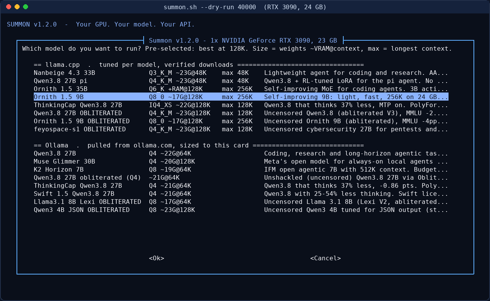
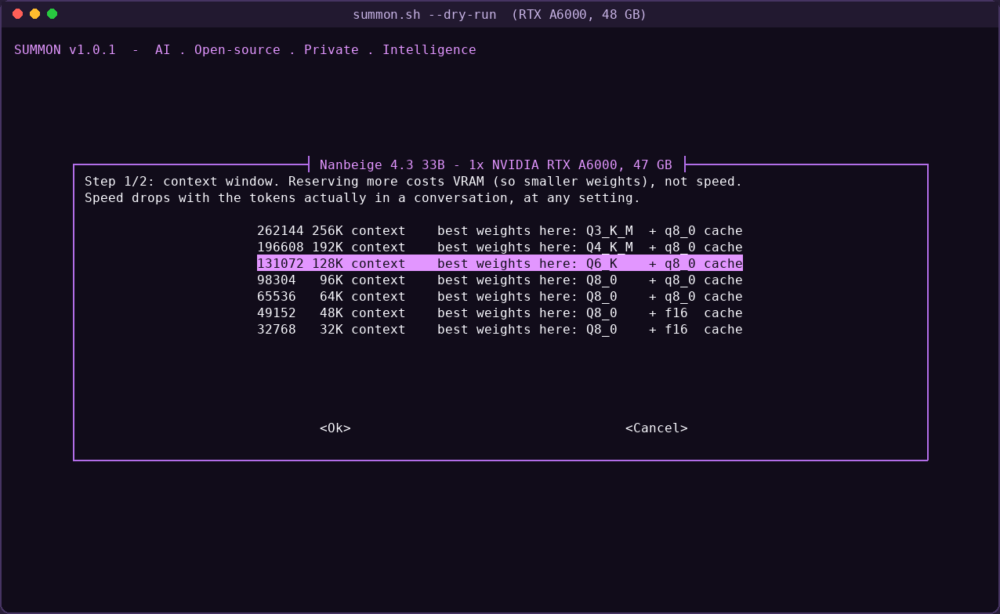
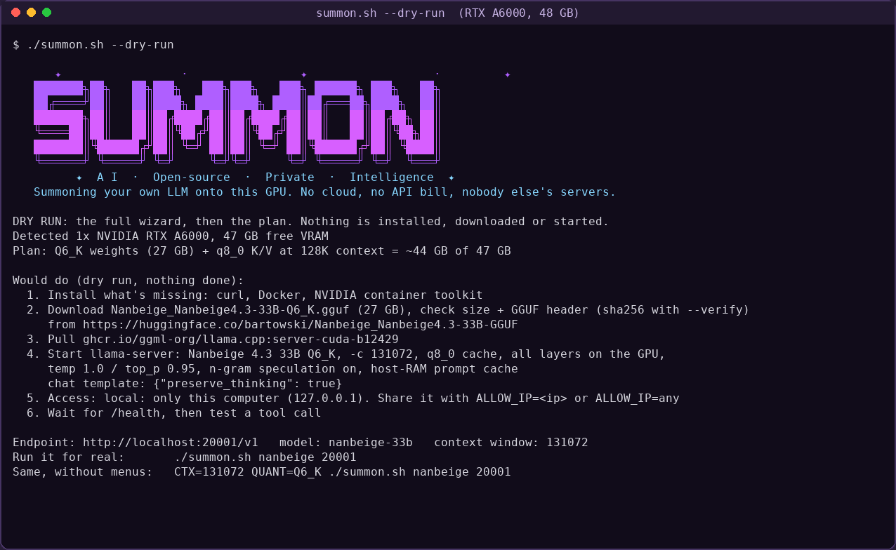

# Summon

**AI · Open-source · Private · Intelligence**

One command turns your NVIDIA GPU into a private AI with an OpenAI-compatible API. Summon picks the model, weights and context that fit your card, verifies the download, keeps the port private and tests tool calling before it hands you the URL. No cloud, no API bill, nobody else's servers.


## Install

**Linux** (Ubuntu/Debian, rented GPU pods):

```bash
curl -fsSL https://codyvolckmar.github.io/summon/install.sh | bash
```

**Windows 10/11** (PowerShell; runs Summon inside WSL 2 with your GPU):

```powershell
irm https://raw.githubusercontent.com/codyvolckmar/summon/main/docs/install.ps1 | iex
```

**Just looking?** The full wizard, nothing installed:

```bash
curl -fsSL https://codyvolckmar.github.io/summon/install.sh | bash -s -- --dry-run
SUMMON_GPU="RTX 3090:24576" ./summon.sh --dry-run     # preview a card you don't have
```

Piping a script into a shell gives it root. Read [summon.sh](summon.sh) first; it's one commented file.

## What you can summon

| Model | Engine | 24 GB (RTX 3090/4090) | 48 GB (RTX A6000) |
|---|---|---|---|
| **Nanbeige 4.3 33B**: agentic coding, Artificial Analysis index 20 (top of the ≤40B class) | llama.cpp | up to 48K | 128K (Q6_K) · 256K (Q3_K_M) |
| **Ornith 1.5 35B**: fast MoE, ~3B active (vendor benchmarks) | llama.cpp | doesn't fit | 256K, 8-bit weights |
| **Ornith 1.5 9B**: fast and light (vendor benchmarks) | llama.cpp | 256K, 8-bit weights | 256K, 8-bit weights |
| **Ollama models**: Qwen3.8 27B, Qwen3.6 35B-A3B, Gemma 4 31B, K2 Horizon, Muse Glimmer… | Ollama | Qwen3.8 27B at 64K | most at 128K, 8-bit |

## Usage

```bash
./summon.sh [PORT]                          # the wizard
./summon.sh nanbeige|ornith35b|ornith9b|ollama [PORT]   # skip the first menu
./summon.sh --dry-run [PORT]                # plan only, installs nothing
./summon.sh --lock [PORT]                   # re-lock a rented pod's port to your current IP
./summon.sh --uninstall [llamacpp|ollama]   # remove an engine and its model files
./summon.sh --help                          # every option (CTX, QUANT, ALLOW_IP, SPEC, ...)
```

Then point any OpenAI-compatible client at `http://localhost:PORT/v1` (rented pod: `http://<pod-ip>:PORT/v1`) with any API key, and set its context window to the number Summon prints.

**Access:** on your own PC (no SSH session) the server only listens on `127.0.0.1`. Over SSH (rented pods) it's firewalled to the IP you SSH in from. `ALLOW_IP=1.2.3.4,192.168.1.0/24` shares it with those addresses, `ALLOW_IP=any` opens it.

## How it decides

- **Context first, then precision.** Every token reads all the weights plus the part of the cache in use, so reserving a long context costs VRAM, not speed. Summon defaults to 128K with the most precise weights that still fit, and never uses a 4-bit cache.
- **Each model's own chat template** (llama.cpp `--jinja`), so native tool calls and thinking blocks work. That's why Nanbeige and Ornith run on llama.cpp: Ollama's builds of them ship without tool support.
- **Every layer on the GPU** (`--fit off`): if it doesn't fit, it fails loudly instead of silently crawling on the CPU.
- **Host-RAM prompt cache** so side requests (chat titles, subagents) don't evict a 200K-token conversation; **n-gram speculative decoding** (lossless) for code rewrites.

## Screenshots

| | |
|---|---|
|  |  |
|  |  |
|  |  |

Regenerate them with `python3 tools/termshot.py` (drives the real script in a pseudo-terminal).

## Status

Young project, [MIT licensed](LICENSE). The Nanbeige llama.cpp setup has served real agent work on rented RTX A6000 pods. The full wizard, the Windows/WSL path and the Ornith models have only been tested with dry runs and simulated GPUs so far. Ornith's benchmarks are the vendor's own. Issues and pull requests welcome.

Models belong to their creators and carry their own licences: Nanbeige (Apache-2.0), Ornith (MIT), Ollama models as listed.
