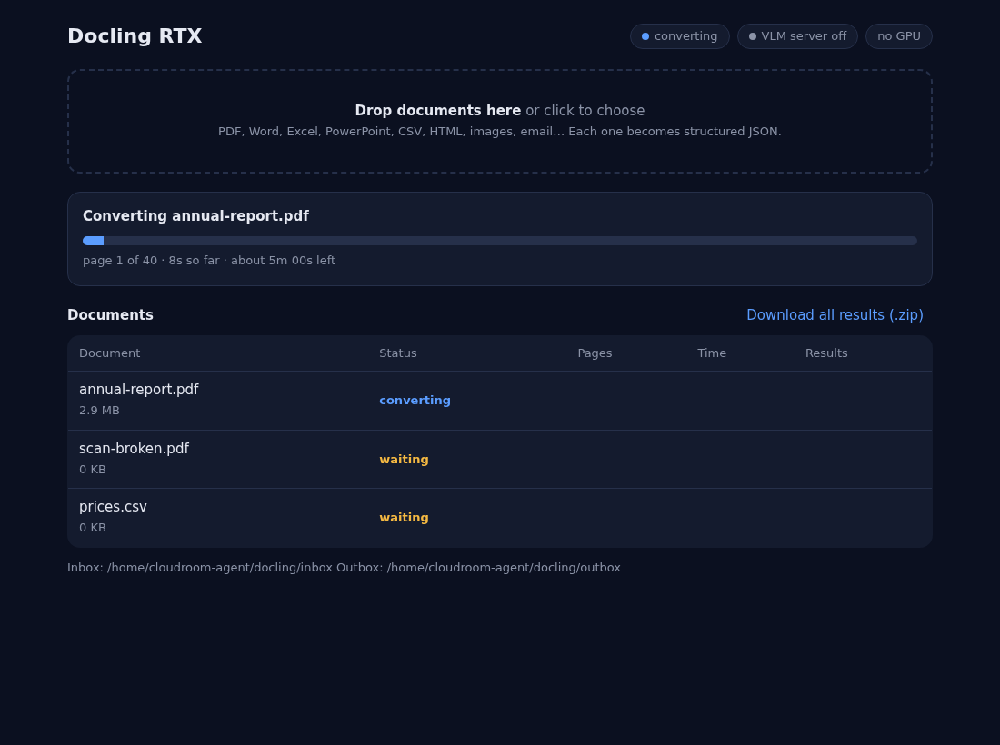
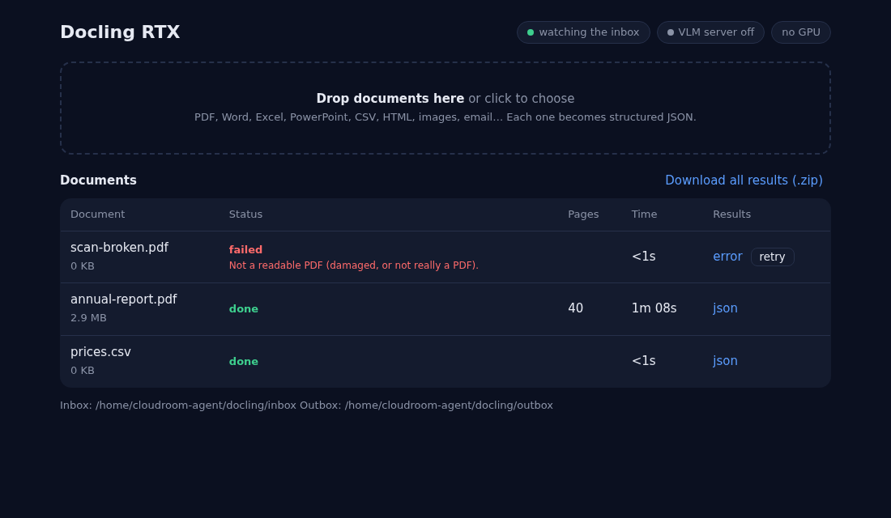
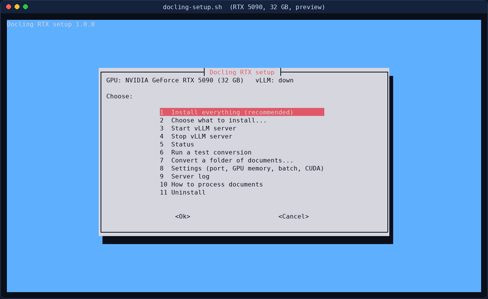
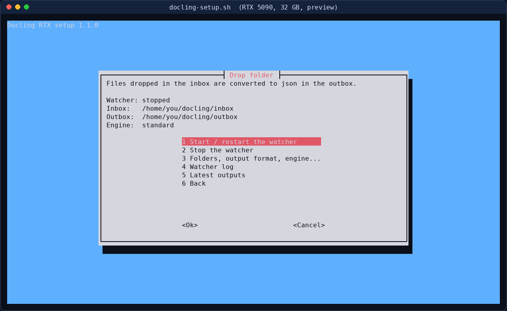
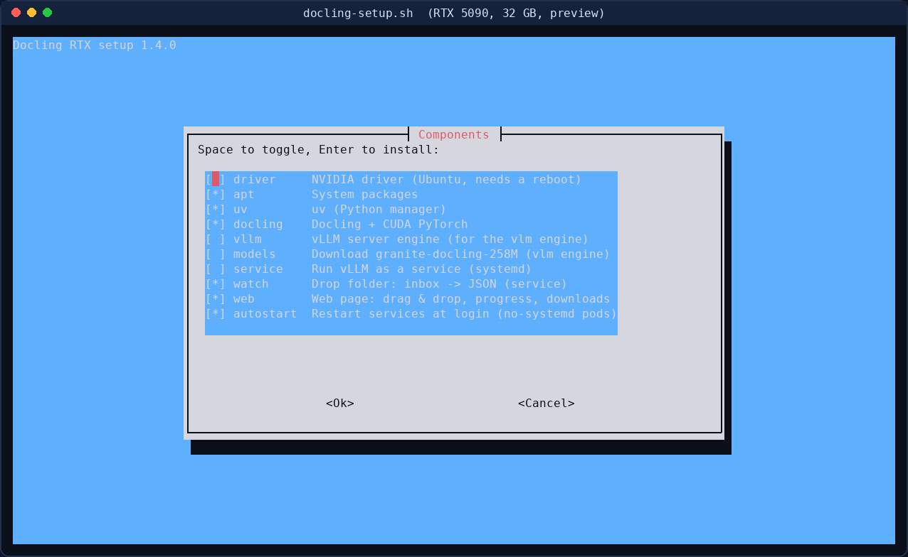

# Docling RTX

**One command turns a rented or local Linux box with an NVIDIA GPU into a document-processing machine.** Drag PDFs, CSVs, Office files, HTML or images onto a web page (or drop them in a folder), and structured JSON for your AI agent comes out.

It installs [Docling](https://github.com/docling-project/docling) on CUDA PyTorch and serves IBM's [granite-docling-258M](https://huggingface.co/ibm-granite/granite-docling-258M) vision-language model with vLLM, the fast path from Docling's [RTX guide](https://docling-project.github.io/docling/getting_started/rtx/#5-install-and-run-docling). Forked from [Summon](https://github.com/codyvolckmar/summon).



## Use it in 3 steps

**1. Install** (Ubuntu 22.04/24.04 or Debian 12, an NVIDIA GPU, ~20 GB of disk). On the GPU server:

```bash
curl -fsSL https://raw.githubusercontent.com/codyvolckmar/docling-rtx/main/install.sh | bash
```

It runs for a few minutes and ends with a **How to use** box that has your web address.

**2. Open the web page.** It listens on the server only. From your laptop, add `-L 8080:127.0.0.1:8080` to the ssh command you already use for the server, then open **http://localhost:8080**:

```bash
ssh -L 8080:127.0.0.1:8080 root@<server> -p <port>      # keep this open while you use the page
```

**Your provider gave you a port?** Most GPU pods expose only certain ports, often mapped to a different public number. Tell Docling RTX which one, at install or any time later:

```bash
curl -fsSL https://raw.githubusercontent.com/codyvolckmar/docling-rtx/main/install.sh | WEB_PORT=40123 WEB_PUBLIC=1 bash
docling-rtx web port 40123             # change it later: the page listens on 40123
docling-rtx web port 40123 41234       # ...and your provider maps 40123 to public port 41234
docling-rtx web public | private       # direct link with a key / SSH tunnel only
```

Or use the menu: `docling-rtx`, Settings. Public mode prints `http://<server-ip>:<public port>/?token=...`, protected by a random key. On Vast.ai the public port is detected automatically. It's plain HTTP, so use the SSH tunnel on untrusted networks.

**3. Drag documents onto the page.** Each one shows *waiting*, then *converting* with a page-by-page progress bar and time left, then *done* with a **json** link. Failures say why in plain English and have a **retry** button. **Download all results (.zip)** gets everything. **Cancel** stops a running document. **Clear finished** empties the list: originals move to `~/docling/archive/`, and the JSON stays in the outbox.



**No browser?** Copy files into `~/docling/inbox` and collect `~/docling/outbox/<name>.json`, the same pipeline. `docling-rtx watch logs` shows progress, with a line every 10% for long PDFs. The rules for an AI agent reading the outbox are in [GUIDE.md](GUIDE.md#0-the-web-page-and-the-drop-folder-the-main-workflow).

**Rented pods without systemd** (most container GPU hosts): the converter, web page and vLLM run in the background and **start again when you log in** after a reboot. With systemd they're services that start on boot.

`docling-rtx` is the command for everything afterwards: `docling-rtx` (menu), `docling-rtx status`, `docling-rtx howto`. To see the plan without installing: `./docling-setup.sh --dry-run` (preview another card with `DOCLING_GPU="RTX 3090:24576:580.95:8.6"`).



## What it does

| Step | What |
|---|---|
| Check | Finds the GPU, VRAM and driver. Picks the PyTorch CUDA build from the driver: cu130 (driver 580+), cu128 (570+, needed for RTX 50) or cu126. Without a driver, it offers to install one (`ubuntu-drivers`, then reboot) or carries on CPU-only. |
| System | `apt`: curl, git, whiptail, build-essential (Triton compiles kernels), libgl1/libglib2.0 (OpenCV). |
| Python | [uv](https://docs.astral.sh/uv/) with its own Python 3.12, so the system Python is left alone. |
| Docling | `~/.docling-rtx/venv`: CUDA PyTorch from download.pytorch.org, then `docling`. Prints whether CUDA is available. |
| vLLM | `~/.docling-rtx/vllm`, a separate venv because vLLM pins its own torch. |
| Models | granite-docling-258M (the `untied` revision the model card uses for vLLM, plus `main` for in-process use). Docling's layout/table/OCR models download on first use. |
| Server | `vllm serve` with the RTX guide's settings (`--max-num-seqs 512 --max-num-batched-tokens 8192 --enable-chunked-prefill`), sized to the card: 0.5 of the GPU instead of 0.9 so the drop folder's standard pipeline fits alongside; under 10 GB, 32 parallel pages and 0.7 of the GPU; float16 on pre-RTX 30 cards, on `127.0.0.1:8000` only. Runs as the systemd unit `docling-vllm`, which starts on boot; without systemd it runs as a background process. |
| Drop folder | The `docling-watch` service watches `~/docling/inbox` and writes `<name>.json` (a DoclingDocument) to `~/docling/outbox`, atomically, or `<name>.error.json` on failure. Changed files are converted again. The handover rules are in [GUIDE.md](GUIDE.md#0-the-web-page-and-the-drop-folder-the-main-workflow). |
| Web page | `docling-web` (or a background process): drag & drop upload into the inbox, live progress from the watcher, downloads, retry. Python standard library only, on `127.0.0.1:8080` (`docling-rtx web public` for a direct link with a key). |
| Test | `./docling-setup.sh test` converts the Docling paper with both engines into `~/.docling-rtx/test-output/`. |

You don't need the CUDA Toolkit or cuDNN, steps 2-3 of the RTX guide: the PyTorch and vLLM wheels bundle the CUDA runtime and cuDNN. Only the driver matters.





## Commands

```bash
docling-rtx                           # menu (same as ./docling-setup.sh)
docling-rtx install                   # full install, no questions (--auto / -y)
docling-rtx howto                     # the web address and how to use it
docling-rtx status                    # GPU, CUDA, vLLM / converter / web page up or down
docling-rtx web [url|start|stop|logs|public|private]   # the web page
docling-rtx web port <port> [public port]              # its port (and the provider's public port)
docling-rtx watch start|stop|restart|logs              # the drop folder (logs = progress)
docling-rtx start|stop|restart|logs   # the vLLM server
docling-rtx test                      # convert the Docling paper with both engines
docling-rtx uninstall                 # remove ~/.docling-rtx, commands and services (keeps your documents)
./docling-setup.sh --dry-run          # print the plan, change nothing

docling-convert --help                # the converter, for one-off batches
```

Settings live in `~/.docling-rtx/config.env` (menus 3 and 9): `PORT=8000`, `GPU_UTIL=auto`, `BATCH=auto` (64 for 32 GB, 32 for 24 GB, 16 below), `CUDA=auto`, `INBOX`, `OUTBOX`, `WATCH_ENGINE=standard` and `WATCH_FORMATS=json`.


## Files

| File | |
|---|---|
| [install.sh](install.sh) | One-line installer: clones the repo and runs the install |
| [docling-setup.sh](docling-setup.sh) | Installer, menu and the `docling-rtx` command |
| [web.py](web.py) | The web page (standard library only) |
| [convert.py](convert.py) | Converter: files/folders/URLs, three engines (`standard`, `vlm`, `local`), `--watch` drop-folder mode, atomic writes, skips finished documents |
| [GUIDE.md](GUIDE.md) | How to process documents once it's live |
| [tools/termshot.py](tools/termshot.py) | Regenerates the screenshots (real whiptail in a pseudo-terminal) |

## Tested
- **Web page (headless Chromium):** three files picked on the page uploaded into the inbox. The 40-page PDF showed live page progress and converted in 1m08s on a CPU-only sandbox. The CSV converted. The broken PDF showed "Not a readable PDF" with a working retry. Downloads, the zip, path-traversal attempts (404), the public key mode (403 without the key) and the no-systemd path (a simulated reboot, then services back at login) were all checked.

- **Drop folder (same box, as the systemd service):** a PDF, CSV, DOCX, XLSX, HTML page and PNG were all converted to JSON. Tables came through as cells, the PNG was OCR'd, and the HTML list stayed a list. Edited files were converted again. A corrupt PDF produced `.error.json` once and wasn't retried. A file written in two parts ended up complete.
- **CPU-only box (Debian 12, no GPU):** full `install`, then `test`. The standard engine converted the 8-page Docling paper in 36 s. `--engine local` (granite-docling in-process) and `--engine vlm` (against an OpenAI-compatible mock of the vLLM API) both produced Markdown. Reruns skip finished documents, and a corrupt PDF fails on its own without stopping the batch.
- **Not yet run on a real RTX GPU:** the vLLM install, the `docling-vllm` service and real granite-docling output from vLLM. Run `./docling-setup.sh test` on the first GPU box and check `~/.docling-rtx/test-output/vlm`.

## License

MIT (see [LICENSE](LICENSE)). Docling is MIT. granite-docling-258M is Apache 2.0. vLLM is Apache 2.0.
