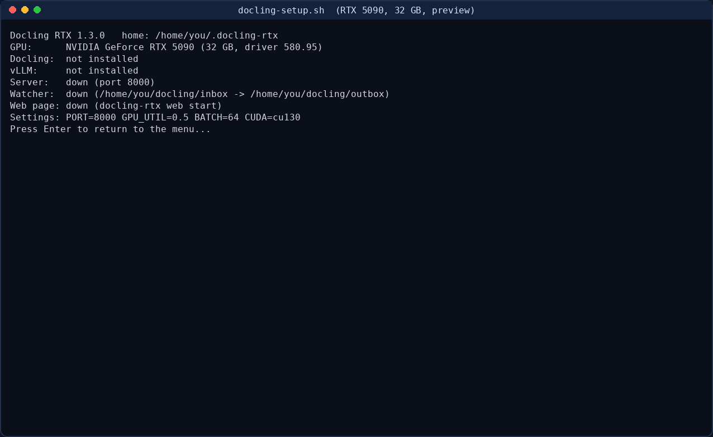

# Docling RTX

**One script turns a fresh Linux box with an NVIDIA RTX card into a GPU document-processing machine.** Drop PDFs, CSVs, Office files, HTML or images into `~/docling/inbox`, and structured JSON for your AI agent appears in `~/docling/outbox`.

It installs [Docling](https://github.com/docling-project/docling) (PDF, Office, HTML and images to Markdown/JSON/HTML) on CUDA PyTorch. It also serves IBM's [granite-docling-258M](https://huggingface.co/ibm-granite/granite-docling-258M) vision-language model with vLLM, the fast path from Docling's [RTX guide](https://docling-project.github.io/docling/getting_started/rtx/#5-install-and-run-docling). You drive it from a whiptail menu, then convert documents with one command.

Forked from [Summon](https://github.com/codyvolckmar/summon), keeping its approach: one commented bash file, a whiptail menu, a dry run and real screenshots.


## Install

Ubuntu 22.04/24.04 or Debian 12 (WSL 2 works too), an NVIDIA RTX GPU, ~20 GB of disk and sudo:

```bash
git clone https://github.com/codyvolckmar/docling-rtx && cd docling-rtx
./docling-setup.sh            # menu -> 1 "Install everything"
./docling-setup.sh install    # or: the same without questions
```

Then drop documents in:

```bash
cp *.pdf *.csv *.docx ~/docling/inbox/     # a few seconds later: ~/docling/outbox/<name>.json
```

Or convert by hand:

```bash
docling-convert ~/documents -o ~/converted --to json       # one-off batch, Docling's GPU models
docling-convert scans/ --engine vlm --to md --to json      # granite-docling via vLLM
```

**[GUIDE.md](GUIDE.md) is the how-to for processing documents**: engines, formats, batch sizes, chunks for RAG, the Python API and troubleshooting.

To see the plan first: `./docling-setup.sh --dry-run`. To preview a card you don't have: `DOCLING_GPU="RTX 4090:24564:575.64" ./docling-setup.sh --dry-run`.

## What it does

| Step | What |
|---|---|
| Check | Finds the GPU, VRAM and driver. Picks the PyTorch CUDA build from the driver: cu130 (driver 580+), cu128 (570+, needed for RTX 50) or cu126. Without a driver, it offers to install one (`ubuntu-drivers`, then reboot) or carries on CPU-only. |
| System | `apt`: curl, git, whiptail, build-essential (Triton compiles kernels), libgl1/libglib2.0 (OpenCV). |
| Python | [uv](https://docs.astral.sh/uv/) with its own Python 3.12, so the system Python is left alone. |
| Docling | `~/.docling-rtx/venv`: CUDA PyTorch from download.pytorch.org, then `docling`. Prints whether CUDA is available. |
| vLLM | `~/.docling-rtx/vllm`, a separate venv because vLLM pins its own torch. |
| Models | granite-docling-258M (the `untied` revision the model card uses for vLLM, plus `main` for in-process use). Docling's layout/table/OCR models download on first use. |
| Server | `vllm serve` with the RTX guide's settings (`--max-num-seqs 512 --max-num-batched-tokens 8192 --enable-chunked-prefill`), but with `--gpu-memory-utilization 0.5` instead of 0.9 so the drop folder's standard pipeline fits on the same card, on `127.0.0.1:8000` only. Runs as the systemd unit `docling-vllm`, which starts on boot; without systemd it runs as a background process. |
| Drop folder | The `docling-watch` service watches `~/docling/inbox` and writes `<name>.json` (a DoclingDocument) to `~/docling/outbox`, atomically, or `<name>.error.json` on failure. Changed files are converted again. The handover rules are in [GUIDE.md](GUIDE.md#0-the-drop-folder-the-main-workflow). |
| Test | `./docling-setup.sh test` converts the Docling paper with both engines into `~/.docling-rtx/test-output/`. |

You don't need the CUDA Toolkit or cuDNN, steps 2-3 of the RTX guide: the PyTorch and vLLM wheels bundle the CUDA runtime and cuDNN. Only the driver matters.


## Commands

```bash
./docling-setup.sh                    # menu
./docling-setup.sh install            # full install, no questions (--auto / -y)
./docling-setup.sh --dry-run          # print the plan, change nothing
./docling-setup.sh start|stop|restart # the vLLM server
./docling-setup.sh status             # GPU, versions, CUDA yes/no, server up/down, GPU memory
./docling-setup.sh test               # convert the Docling paper with both engines
./docling-setup.sh logs               # vLLM server log
./docling-setup.sh watch start|stop|restart|logs   # the drop folder
./docling-setup.sh uninstall          # remove ~/.docling-rtx, launchers and the service

docling-convert --help                # the batch converter (convert.py)
docling --help                        # the plain Docling CLI, from the same venv
```

Settings live in `~/.docling-rtx/config.env` (menus 3 and 9): `PORT=8000`, `GPU_UTIL=0.5`, `BATCH=auto` (64 for 32 GB, 32 for 24 GB, 16 below), `CUDA=auto`, `INBOX`, `OUTBOX`, `WATCH_ENGINE=standard` and `WATCH_FORMATS=json`.



## Files

| File | |
|---|---|
| [docling-setup.sh](docling-setup.sh) | Installer and menu |
| [convert.py](convert.py) | Converter: files/folders/URLs, three engines (`standard`, `vlm`, `local`), `--watch` drop-folder mode, atomic writes, skips finished documents |
| [GUIDE.md](GUIDE.md) | How to process documents once it's live |
| [tools/termshot.py](tools/termshot.py) | Regenerates the screenshots (real whiptail in a pseudo-terminal) |

## Tested

- **Drop folder (same box, as the systemd service):** a PDF, CSV, DOCX, XLSX, HTML page and PNG were all converted to JSON. Tables came through as cells, the PNG was OCR'd, and the HTML list stayed a list. Edited files were converted again. A corrupt PDF produced `.error.json` once and wasn't retried. A file written in two parts ended up complete.
- **CPU-only box (Debian 12, no GPU):** full `install`, then `test`. The standard engine converted the 8-page Docling paper in 36 s. `--engine local` (granite-docling in-process) and `--engine vlm` (against an OpenAI-compatible mock of the vLLM API) both produced Markdown. Reruns skip finished documents, and a corrupt PDF fails on its own without stopping the batch.
- **Not yet run on a real RTX GPU:** the vLLM install, the `docling-vllm` service and real granite-docling output from vLLM. Run `./docling-setup.sh test` on the first GPU box and check `~/.docling-rtx/test-output/vlm`.

## License

MIT (see [LICENSE](LICENSE)). Docling is MIT. granite-docling-258M is Apache 2.0. vLLM is Apache 2.0.
