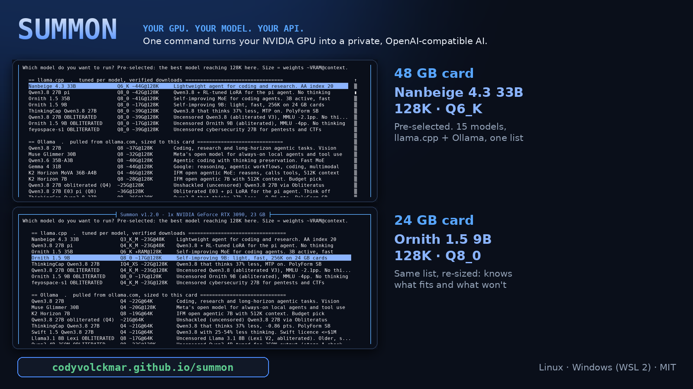
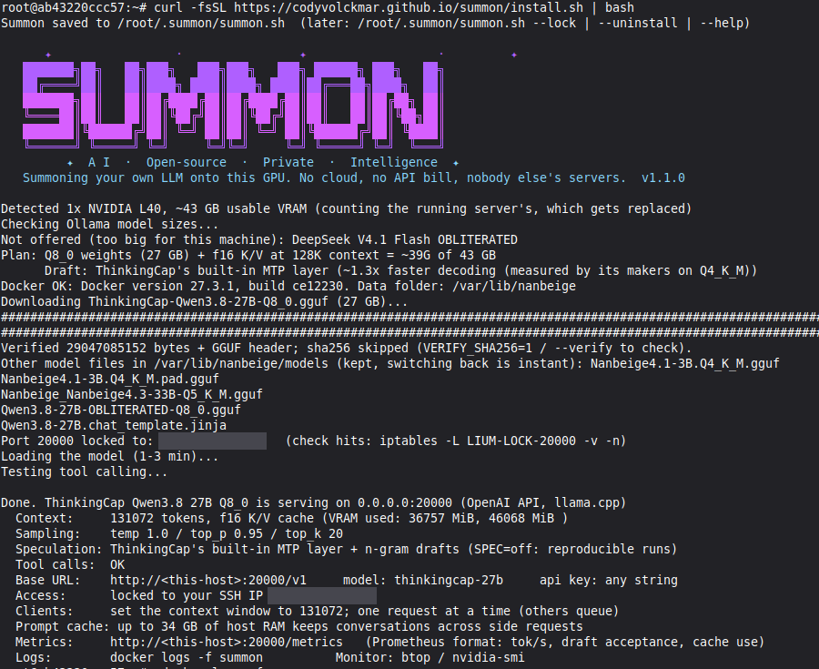
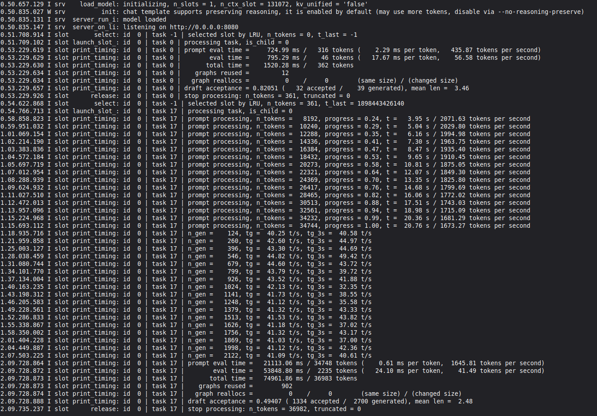
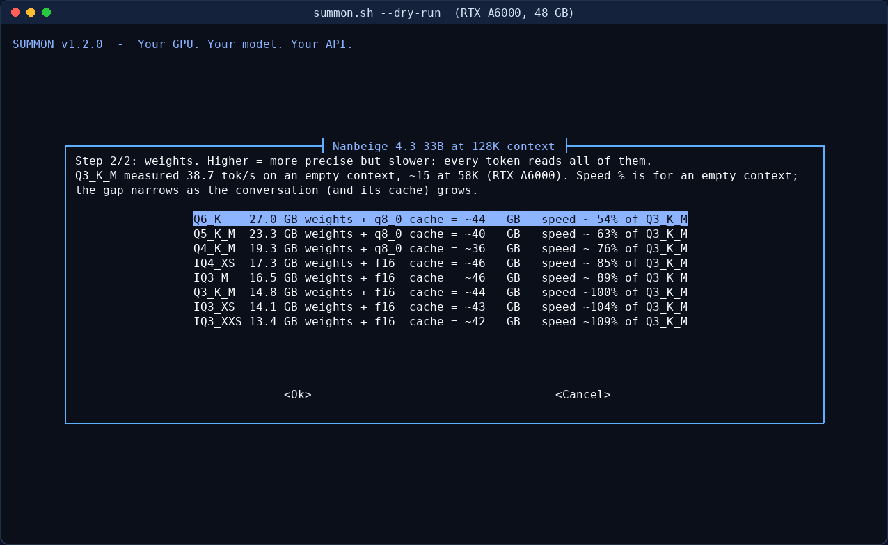
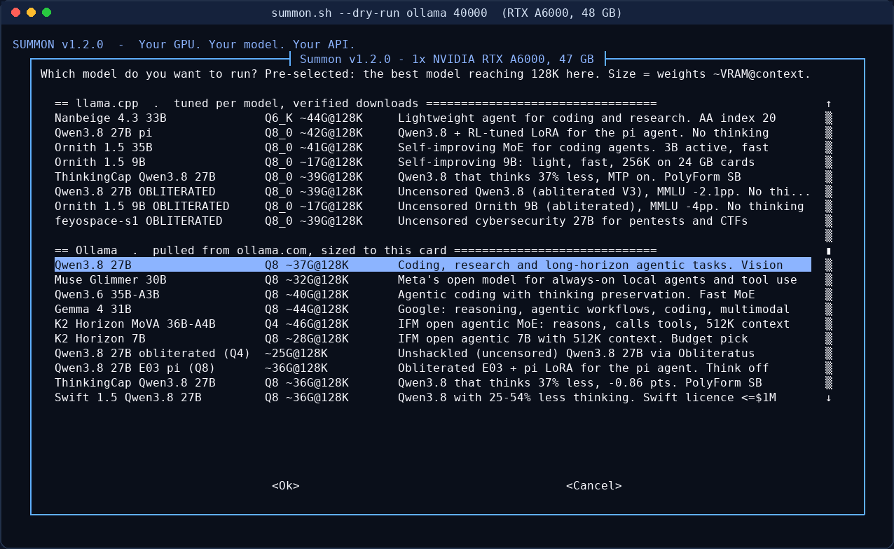
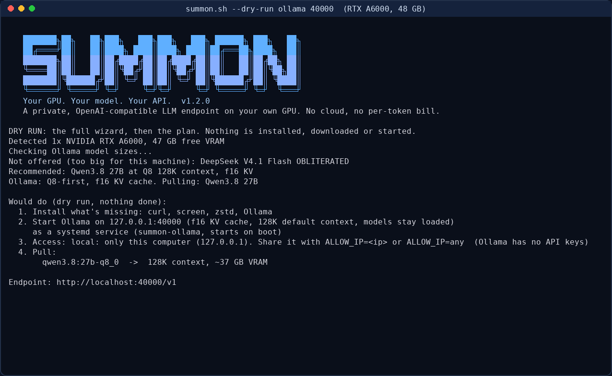

# Summon

**Your GPU. Your model. Your API.**  ·  v1.2.0 ([changelog](CHANGELOG.md))

One command turns your NVIDIA GPU into a private AI with an OpenAI-compatible API. Summon picks the model, weights and context that fit your card, verifies the download, keeps the port private and tests tool calling before it hands you the URL. No cloud, no API bill, nobody else's servers.



## Install

**Linux** (Ubuntu/Debian, rented GPU pods):

```bash
curl -fsSL https://codyvolckmar.github.io/summon/install.sh | bash
```

**Windows 10/11** (PowerShell; runs Summon inside WSL 2 with your GPU):

```powershell
irm https://raw.githubusercontent.com/codyvolckmar/summon/main/docs/install.ps1 | iex
```

**Just looking?** The full wizard, nothing installed:

```bash
curl -fsSL https://codyvolckmar.github.io/summon/install.sh | bash -s -- --dry-run
SUMMON_GPU="RTX 3090:24576" ./summon.sh --dry-run     # preview a card you don't have
```

Piping a script into a shell gives it root. Read [summon.sh](summon.sh) first; it's one commented file.

## Models

**New:** OBLITERATUS's abliterated models, up to the 748B DeepSeek V4.1 Flash, set up correctly on llama.cpp. See [OBLITERATUS.md](OBLITERATUS.md).

| Model | Engine | 24 GB (RTX 3090/4090) | 48 GB (RTX A6000) |
|---|---|---|---|
| **Nanbeige 4.3 33B**: agentic coding, Artificial Analysis index 20 (top of the ≤40B class) | llama.cpp | up to 48K | 128K (Q6_K) · 256K (Q3_K_M) |
| **Qwen3.8 27B pi**: Qwen3.8 27B + a LoRA RL-tuned to drive the [pi](https://github.com/earendil-works/pi) coding agent, thinking off (vendor benchmarks) | llama.cpp | ~48K (Q4_K_M) | 256K, 8-bit weights |
| **Ornith 1.5 35B**: fast MoE, ~3B active (vendor benchmarks) | llama.cpp | 128K with experts in RAM (needs ~30 GB free RAM) | 256K, 8-bit weights |
| **Ornith 1.5 9B**: fast and light (vendor benchmarks) | llama.cpp | 256K, 8-bit weights | 256K, 8-bit weights |
| **ThinkingCap Qwen3.8 27B**: Qwen3.8 27B that thinks ~37% less (vendor: -0.86 pts), built-in MTP head. PolyForm Small Business licence | llama.cpp | 128K, IQ4_XS | 128K, 8-bit weights |
| **Qwen3.8 27B OBLITERATED**: uncensored Qwen3.8 (OBLITERATUS V3 abliteration; vendor MMLU -2.1pp), thinking off, served with Qwen3.8's own template so tool calls work | llama.cpp | 128K, Q4_K_M | 256K, 8-bit weights |
| **Ornith 1.5 9B OBLITERATED**: uncensored Ornith 9B (vendor MMLU -4pp), thinking off | llama.cpp | 256K, 8-bit weights | 256K, 8-bit weights |
| **feyospace-s1 OBLITERATED**: uncensored ~28B tuned for cybersecurity (pentests, CTFs, vuln research; vendor WMDP-Cyber 63.8%). Isolate its tools | llama.cpp | 128K, Q4_K_M | 256K, 8-bit weights |
| **DeepSeek V4.1 Flash OBLITERATED**: uncensored 748B MoE (refusals reduced, not removed; MMLU 83.6%), 2.66-bit GGUF, 237 GB download. Needs a 96 GB card + ~130 GB free RAM, or ~160 GB of VRAM across cards | llama.cpp | not offered | not offered |
| **Ollama models**: Qwen3.8 27B, Qwen3.6 35B-A3B, Gemma 4 31B, K2 Horizon, Muse Glimmer… | Ollama | Qwen3.8 27B at 64K | most at 128K, 8-bit |

## What should I rent?

| GPU (VRAM) | Typical price | What Summon runs on it |
|---|---|---|
| RTX 3090 / 4090 (24 GB) | ~$0.15–0.75/hr | Ornith 1.5 9B at 128K, 8-bit. ThinkingCap / Qwen3.8 27B at 128K, 4-bit. Ornith 35B with experts in RAM |
| RTX 5090 (32 GB) | ~$0.40–1.00/hr | ThinkingCap / Qwen3.8 27B at 128K, 6-bit |
| **L40S / L40 / RTX A6000 (48 GB)** | ~$0.80–1.10/hr (L40S) | **Best value.** Nanbeige 33B at 128K, 6-bit; ThinkingCap, Qwen3.8, Ornith 35B at 128K, 8-bit (~42 tok/s measured on an L40) |
| H100 (80 GB) | ~$2.20–2.90/hr | Every 27–35B model at 8-bit, fastest per token |
| RTX PRO 6000 (96 GB) + 130 GB RAM | ~$0.60–2.10/hr | Everything, including DeepSeek V4.1 Flash 748B (experts in RAM) |
| 2× H100 (160 GB) | ~$4.40–5.80/hr | DeepSeek V4.1 Flash fully on the GPUs |

Prices are typical RunPod and Vast.ai rates (Sept–Nov 2026) and change daily. Check any card first: `SUMMON_GPU="L40S:46068" ./summon.sh --dry-run`.

## Usage

```bash
./summon.sh [PORT]                          # the wizard: one menu with every model, sized to your card
./summon.sh --auto [PORT]                   # just go: the recommended model, no questions (or GO=1)
./summon.sh status                          # what's running, health, last speed, GPU memory
./summon.sh nanbeige|qwen38pi|ornith35b|ornith9b|thinkingcap|qwen38obl|ornith9bobl|feyospace|deepseek41obl [PORT]   # skip the menu
ONLY=1,3 ./summon.sh [PORT]                 # pull several Ollama models at once (rows in list order)
./summon.sh --dry-run [PORT]                # plan only, installs nothing
./summon.sh --connect                       # chat page, API key and client setup of the running server
TUNNEL=1 ./summon.sh [PORT]                 # also get a public HTTPS URL (Cursor, phones)
./summon.sh --lock [PORT]                   # firewall the port to your current IP, on top of the key
./summon.sh --uninstall [llamacpp|ollama]   # remove an engine and its model files
./summon.sh --help                          # every option (CTX, QUANT, ALLOW_IP, SPEC, ...)
```

When it's done, Summon prints:
- the **chat page** (llama-server's built-in web chat: open it in a browser, paste the key once);
- the **base URL, model name, API key and context window**;
- **copy-paste setup for Hermes Agent, pi, opencode, OpenClaw and Cursor**, with your values filled in.

`./summon.sh --connect` prints it all again.

**Access:** llama.cpp models need an **API key**, generated once and kept across reruns (`API_KEY=...` to set your own, `--new-key` to rotate). On your own PC the server only listens on `127.0.0.1`. On a rented pod the port is open and the key is the lock; `TUNNEL=1` adds a free HTTPS URL through a Cloudflare quick tunnel. Cursor needs that, because it calls models from its own servers. `ALLOW_IP=1.2.3.4` adds a firewall on top. Ollama has no API keys, so Ollama models keep the IP lock: firewalled to your SSH IP on rented pods, `127.0.0.1` on your own PC.

**Reboots:** llama.cpp runs in Docker and comes back on its own. Ollama runs as the `summon-ollama` systemd service, so it starts on boot too and re-applies its IP lock (iptables rules don't survive a reboot). Machines without systemd, like many pod containers, fall back to a `screen` session: rerun Summon after a reboot there.

## How it decides

- **Only what fits.** The menu lists only models that fit this machine's VRAM (summed over all cards) and, for MoE models with experts in RAM, its free RAM. The rest are named in one line and left out.
- **Context first, then precision.** Every token reads all the weights plus the part of the cache in use, so reserving a long context costs VRAM, not speed. Summon defaults to 128K with the most precise weights that still fit, and never uses a 4-bit cache.
- **Each model's own chat template** (llama.cpp `--jinja`), so native tool calls and thinking blocks work. That's why Nanbeige and Ornith run on llama.cpp: Ollama's builds of them ship without tool support.
- **Every layer on the GPU** (`--fit off`): if it doesn't fit, it fails loudly instead of silently crawling on the CPU.
- **Host-RAM prompt cache** so side requests (chat titles, subagents) don't evict a 200K-token conversation.
- **Speculative decoding** (v1.1.0): each model's draft plus n-gram drafts. Qwen3.8 uses its MTP head (+60-90% measured on base Qwen3.8), Ornith and ThinkingCap their built-in MTP layer (ThinkingCap: ~1.3x, measured by its makers), Nanbeige the optional Nanbeige4.1-3B draft model (~70% faster decoding, ~3x faster tool calls, community-measured). A draft that would cost weight precision on your card is offered, never forced. The model checks every drafted token, so quality holds on average, but outputs aren't bit-identical to a run without it: `SPEC=off` for reproducible runs.
- **MoE experts in system RAM** (v1.1.0): a mixture-of-experts model that doesn't fit VRAM (Ornith 35B on a 24 GB card) keeps its experts in RAM and caches the hot ones on the GPU (llama.cpp `--cpu-moe` + `--moe-cache-mib`), shown as `+RAM` in the menu. Summon only offers it when the GPU cache holds at least 60% of the experts, and never pre-selects it.

## Tested on real hardware

**ThinkingCap Qwen3.8 27B on an NVIDIA L40 (48 GB)**, installed with the one-line installer. It ran Q8_0 weights at 128K context with an f16 cache, using the built-in MTP layer plus n-gram drafts for speculative decoding. The tool-call test passed.

| Request | Prompt | Generated | Decode | Draft acceptance |
|---|---|---|---|---|
| Short | 316 tokens | 46 tokens | **56.6 tok/s** | 82% (mean 3.46 tokens per step) |
| Long | 34,748 tokens at 1,646 tok/s | 2,235 tokens | **41.5 tok/s** | 49% (mean 2.48 tokens per step) |

The acceptance rates show speculative decoding is working: the model accepts about half of the drafted tokens even on a 35K-token context. No baseline with speculation off was recorded, so the exact speed-up on this card is still unmeasured.

| | |
|---|---|
|  |  |

## Screenshots

| | |
|---|---|
|  |  |
|  |  |
|  |  |

Regenerate them with `python3 tools/termshot.py` (drives the real script in a pseudo-terminal).

## Status

Young project, [MIT licensed](LICENSE). The Nanbeige llama.cpp setup has served real agent work on rented RTX A6000 pods, and ThinkingCap 27B has been run end to end on an L40 ([results](#tested-on-real-hardware)). The full wizard, the Windows/WSL path and the Ornith models have only been tested with dry runs and simulated GPUs so far. Ornith's benchmarks are the vendor's own. Issues and pull requests welcome.

Models belong to their creators and carry their own licences: Nanbeige (Apache-2.0), Ornith (MIT), Ollama models as listed.

## Questions?

> **Cody Volckmar** · [cody.volckmar@gmail.com](mailto:cody.volckmar@gmail.com) · X: [x.com/Chillisock7](https://x.com/Chillisock7)
>
> Summon is a free, open-source side project, not a service. Questions, bugs and ideas: [GitHub issues](https://github.com/codyvolckmar/summon/issues). Want to build on it together? Say hi by email or on X.
